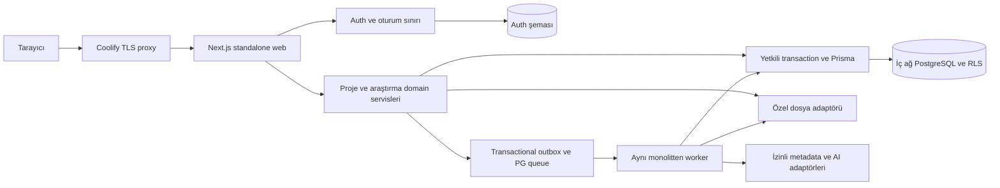

# Mimari

Phase 03 implementation: source-linked Tiptap/KaTeX documents, revision receipts/checkpoints, tasks, project topics and permission-aware Inbox use the existing modular monolith/PostgreSQL. No new worker/realtime service is added; see [ADR 0005](decisions/0005-documents-and-collaboration.md) and [handoff](PHASE_03_HANDOFF.md).

Historical foundation evidence: [Phase 01 handoff](PHASE_01_HANDOFF.md). The Phase 00 candidate/version and future-module planning below is historical design context; exact installed pins and actual gates are recorded per implementation slice. The owner-selected Coolify preview is running; G01 remains open for deferred full live acceptance.

Durum: Faz 00 planı, uygulama yok. Temel karar [ADR 0001](decisions/0001-deployment-and-database.md). Kavramsal veri [DATA_MODEL](DATA_MODEL.md), tüm erişim kuralları [AUTHORIZATION](AUTHORIZATION.md), operasyon [COOLIFY_PLAN](COOLIFY_PLAN.md) içindedir.

## Sınırlar ve çalışma biçimi

Docker/Coolify üzerinde Next.js App Router, React ve TypeScript ile modüler monolit planlanır. PostgreSQL işlem/veri/arama için, Prisma veri erişimi ve migration için kullanılır. Tek repo ve tek ürün modeli vardır. PDF işleme gibi uzun işler başladığında aynı kod tabanından ayrı worker süreci eklenir; bağımsız mikroservis ürünleri kurulmaz.

Diagram planlanan bileşenleri gösterir; kurulmuş servis değildir. AuthDB ile PG aynı Atlas veritabanında ayrı şema/roller olabilir; ikinci DB zorunlu değildir.

| Katman/modül | Sorumluluk | Sınır |
| --- | --- | --- |
| UI / client | Form, okuma konumu, draft, erişilebilir etkileşim | Kimliği/rolü belirleyemez; Prisma, dosya secret'ı veya provider anahtarı içermez |
| Server entry | Server Component, action veya route; oturum, input/size/CSRF/origin denetimi | Her entry private veride aynı domain yetki geçidini kullanır; middleware tek koruma değildir |
| Identity | Better Auth adaptörü, doğrulama/reset, session iptali | Proje rolleri auth kütüphanesinden miras alınmaz; [ADR 0002](decisions/0002-authentication.md) |
| Workspace/projects | Üyelik, davet, proje rolleri, arşiv | Yetkinin tek kaynağı domain membership kayıtları |
| Sources/reader | Metadata provenance, PDF sürümleri, çıkarılmış metin, annotation | Dosya hazır olmadan retrieval uygun olmaz; sürüm byte'ı immutable |
| Documents/collaboration | Optimistic saving, versions, math, tasks, threads, inbox | Faz 03; realtime co-editing yok; aynı-proje linkler |
| AI | Scope snapshot, retrieval, kanıt validasyonu, proposal, usage | Faz 04; bağımsız authorization kapısı; provider adapter değişebilir |
| DAL | Yetkili transaction helper, query scope, pagination, RLS context | Domain modülleri dışından doğrudan Prisma sorgusu yok; DTO yalnız gereken alanları verir |
| Jobs/ops | Outbox dispatch, retry, cancel, backup orchestration, telemetry | Job ID izin değildir; actor/resource yeniden kontrolü gerekir |

Import yönü UI → server/domain → authorization/DAL/adapters'dır. Modüller birbirinin tablolarını UI'dan sorgulamaz; domain servisleri ve kimlikli artifact referansları üzerinden bağlanır. Ortak çekirdek yalnız IDs, access context, error/result ve transaction sınırıdır; her şeyi bilen ortak service oluşturulmaz.

## İstek ve işleme sözleşmesi

Özel okuma: server session doğrula → route resource parent'ını DB'den çöz → workspace/proje kilit sırasıyla transaction → membership/rol kontrolü → transaction-local actor ayarı → RLS korumalı sorgu → izinli DTO. İstemcinin gönderdiği workspace/project/actor değeri güvenilir değildir. Aynı model listeler, arama, asset proxy, versions, notifications ve export için geçerlidir.

Yazma: yukarıdaki yol + beklenen revision + aynı-proje kısıtları + değişiklik/outbox/audit aynı transaction → commit → istemciye kabul edilen revision. DB hatası kullanıcıya alan/conflict/retry/unavailable olarak çevrilir; ham SQL veya özel içerik dönmez.

Uzun işlem: request izinli job kaydı üretir; outbox queue'ya iletir. Worker payload'tan SQL/dosya yolu/prompt çalıştırmaz; yalnız job ID ve sabit task türü alır. İçerik okurken, provider'a göndermeden, sonucu yazarken ve kullanıcıya teslim ederken güncel aktör erişimini kontrol eder. İptal edilen job sonuçları paylaşılmaz. Sistem cleanup işi kendi dar operasyon yetkisini kullanır, kullanıcı içerik okuma yetkisi kazanmaz.

Arama: önce proje/üyelik filtresi, sonra PostgreSQL metadata/full-text sorgusu, sıralama ve pagination. Sonuç toplamı/snippet de filtrelidir. Kaynak bibliyografyası global özel veri deposu olarak paylaşılmaz. PDF text extraction çıktıları sürüme bağlı ve özel tutulur. pgvector Faz 04 ölçümleri gerektirirse [AI sözleşmesi](AI_AND_SOURCE_CONTRACT.md) kapsamında değerlendirilir; Phase 00/01 bağımlılığı değildir.

## Self-host edilebilir seçimler

Beta için Better Auth + PostgreSQL session; özel kalıcı volume + authenticated app proxy; PostgreSQL outbox + Graphile Worker; başlangıçta normal istek/polling seçildi. Gerekçe, alternatifler ve sınırlar [ADR 0002](decisions/0002-authentication.md), [ADR 0003](decisions/0003-tenancy-and-authorization.md), [ADR 0004](decisions/0004-files-jobs-and-realtime.md) içindedir. Hosted auth/storage/realtime aboneliği ve Redis gerekmiyor. Mail teslimi bir SMTP adaptörüdür; gerçek hedef/credentials daha sonra seçilir.

## Güven ve güvenilirlik

- Runtime, auth, queue, migration ve backup veritabanı yetkileri ayrılır; migration secret'ı web/worker'a verilmez.
- Private response/asset/download için shared CDN cache yok; cache varsa kullanıcı+proje+permission revision ile ayrılır ve güvenlik kontrolünü atlamaz. Beta varsayılanı private/no-store.
- URL metadata/PDF fetch server tarafından allowlist, redirect ve DNS/IP kontrolüyle yapılır; loopback/private/link-local/metadata endpoint erişimi reddedilir. Boyut, süre ve redirect sınırı olur. Dosya adı yol değildir; içerik magic byte ile incelenir. PDF parser kaynak kısıtlı worker'da çalışır, JavaScript/embedded execution kapalıdır.
- DB/files ağ geçidi dışında doğrudan yayınlanmaz. HTML render, markdown, math ve bibliyografya escape/sanitize edilir; kullanıcı dosyası ayrı download disposition ve güvenli content type ile sunulur.
- İdempotency anahtarı actor + proje + işlem + request kapsamındadır. Aynı request aynı sonucu verir; yeniden provider çağrısı/kota iki kez üretilmez.
- Deadline, sayfalama, kuyruk concurrency ve upload limiti konfigüre edilir. Retry geçici hata için bounded/backoff; invalid/forbidden tekrar edilmez.
- Loglar request/job ID, süre ve hata sınıfı içerir; metin/PDF/quote/provider cevabı ve secrets içermez. Erişim değişiklikleri içeriksiz audit olayı üretir.

## Araştırılmış uyumluluk ve sabitleme

Resmi kaynaklar 9 Kasım 2026'da incelendi; hiçbir paket kurulmadı veya kombinasyon çalıştırılmadı. **Aday baseline** Node 24 LTS + Next.js 16 ailesi + uygun React/TypeScript + Prisma 7 ailesi + PostgreSQL 18'dir. Bu bir patch pin'i veya bütünleşik uyumluluk onayı değildir.

| Kanıt | Sınırlı çıkarım |
| --- | --- |
| [Next.js installation](https://nextjs.org/docs/app/getting-started/installation) | Node minimum 20.9 ve React bağımlılığı belirtiliyor; seçilen patch'in peer/engine bilgisi ayrıca kontrol edilmeli |
| [Next.js deploying](https://nextjs.org/docs/app/getting-started/deploying) | Node/Docker ve standalone dağıtım yolu var; Atlas image'ı henüz yok |
| [Prisma 7 requirements](https://www.prisma.io/docs/orm/v7/reference/system-requirements) | Node 24 aralığı ve TypeScript 5.4+ yer alıyor; başka major'ın gereksinimleri karıştırılmayacak |
| [Prisma 7 databases](https://www.prisma.io/docs/orm/v7/reference/supported-databases) | Self-hosted PostgreSQL 18 listeleniyor |
| [Node release lifecycle](https://nodejs.org/en/about/previous-releases) | Üretimde desteklenen LTS seçilecek; en yeni major otomatik tercih değil |
| [Better Auth Prisma](https://better-auth.com/docs/adapters/prisma) | Prisma adapter ve ayrı migration yolu belgelidir; seçilecek auth/Prisma patch birleşimi yerelde doğrulanacak |

Genel Prisma docs yolu araştırma sırasında farklı major'a yönlendi; bu nedenle sürümlü v7 sayfaları dayanak alındı. API örneği tahmin edilmedi. Faz 01'in ilk PR'ı engine/peer/security advisory, lisans, OS/OpenSSL ve image mimarisini doğrular; exact paket/Node patch/PostgreSQL minor/image digest + lockfile'ı sabitler, gerçek install/build ve auth/session/transaction smoke testiyle karar verir. Başarısızsa aynı PR'da ADR güncellenir. Ayrıntılı kontrol [VERIFICATION_PLAN](VERIFICATION_PLAN.md).
