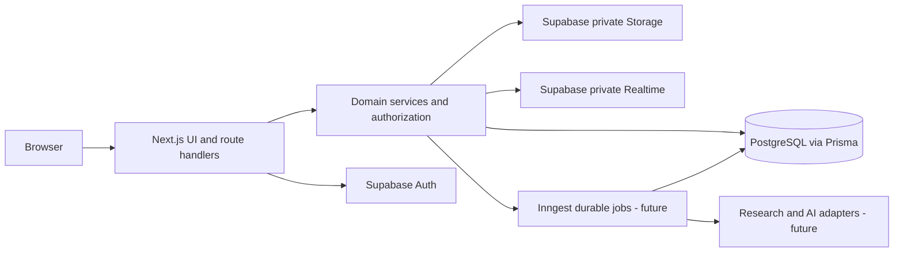
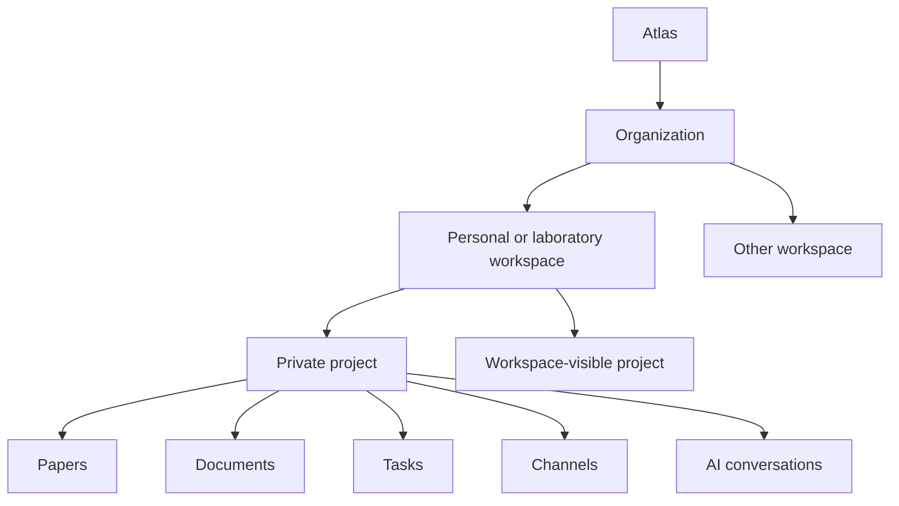
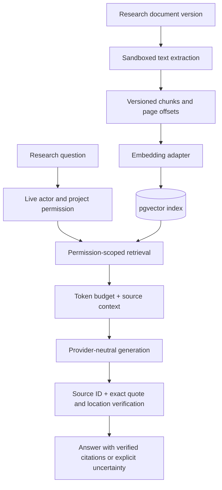

# System architecture

## Decision and package boundaries

One Next.js App Router application, a modular monolith with feature-oriented server services. Routes validate/authorize and call services; services own domain transactions and repository access. `ui` depends on React/Radix; `core` depends on Zod; `ai` is pure TypeScript contracts; `database` owns Prisma/Postgres. No domain imports UI, and no browser module imports database or server secrets. Only preview components and in-memory UI demonstrations exist through Phase 00.5; server domain services below are planned.



```mermaid
sequenceDiagram
 participant B as Browser
 participant R as Route
 participant A as Auth and policy
 participant S as Domain service
 participant D as Postgres
 B->>R: Input + session + request ID
 R->>R: Zod validation and rate limit
 R->>A: Verify identity; resolve resource tenant
 A->>D: Active memberships and project grant
 A-->>R: Scoped capability or denial
 R->>S: Typed input + authorized scope
 S->>D: Tenant-filtered transaction
 D-->>S: Result
 S-->>R: Public DTO
 R-->>B: Envelope + trace ID; no private cache
```



## Domain service map

All mutation contracts return a public entity DTO and request ID, accept validated input and authenticated scope, and return normalized errors from core. Entity IDs alone never imply access. Events below are future durable records written transactionally with state; no event bus is installed.

| Domain                  | Responsibility / entities               | Public contract                                                     | Dependencies and authorization                           | Events / asynchronous work / extensions                     |
| ----------------------- | --------------------------------------- | ------------------------------------------------------------------- | -------------------------------------------------------- | ----------------------------------------------------------- |
| Identity                | Identity/profile linkage, sessions      | verifySession(cookie) → actor; getProfile(actor) → profile          | Supabase verified claims; actor owns profile             | profile.created; account cleanup; federated identity later  |
| Organizations           | Personal/lab tenant lifecycle           | bootstrap(actor, name, key) → org/workspace                         | Identity; transactional owner creation                   | organization.created; export; institutional hierarchy later |
| Workspaces              | Tenant research contexts                | create(scope, name) → workspace; list(actor, cursor) → page         | Org active membership, org admin create                  | workspace.created; indexing; delegated administration later |
| Projects                | Project lifecycle/visibility            | create(scope, input) → project; get(scope,id) → DTO                 | Workspace member create; project capability read/write   | project.created/archived; export jobs; manuscripts later    |
| Memberships             | Roles, invitations, revocation          | invite(scope,email,role) → invite; accept(actor,token) → membership | Admin metadata rights; explicit project owner for grants | membership.changed; email delivery; group grants later      |
| Discovery               | Normalize provider metadata             | search(scope,query,cursor) → provider page                          | Project read; per-actor/provider quota                   | discovery.completed; cache refresh; new adapters            |
| Library                 | Project sources and annotations         | save(scope,providerRecord,key) → ProjectPaper                       | Project editor; shared metadata is not shared PDF access | paper.saved/processed; ingest/index; provenance versioning  |
| Documents               | Notes and immutable versions            | save(scope,id,expectedVersion,content) → version                    | Project editor; own private document ACL if introduced   | document.versioned; extract/index; Yjs later                |
| Tasks                   | Assignment and research work            | create/update(scope,input,expectedVersion) → task                   | Project editor; assignee must be eligible                | task.assigned; notifications; experiments later             |
| Communication           | Channels/messages/threads               | send(scope,channel,clientId,body) → message                         | Project capability AND channel membership if restricted  | message.created; broadcast/mentions; voice later            |
| AI Research             | Grounded generation and citation ledger | submit(scope,conversation,input,key) → run                          | Authorized sources, conversation grant, usage budget     | ai.run.started/completed; RAG; provider adapters            |
| Notifications           | Recipient inbox and deliveries          | list(actor,cursor) → recipient page                                 | Recipient only; reauthorize linked object                | notification.created; email batching; preferences           |
| Search                  | Authorized cross-artifact results       | query(scope,query,types,cursor) → hits                              | Live permission filters; no global private cache         | artifact.index.requested; embeddings/reindex                |
| Billing (future)        | Entitlements and metered plans          | resolveEntitlements(org) → limits                                   | Org billing admin; signed webhook                        | usage.recorded; settlement and reconciliation               |
| Administration (future) | Policy, institution metadata, audits    | administer(scope,policy) → audit result                             | Delegated least privilege; no implicit private content   | policy.changed; audit export                                |
| Experiments (future)    | Protocols/runs/results                  | record(scope,protocol,result) → artifact                            | Project grant plus execution authorization               | experiment.completed; isolated execution later              |
| Manuscripts (future)    | Academic writing/export                 | compile(scope,version) → job                                        | Authorized artifact sources and sandbox policy           | manuscript.compiled; secure LaTeX pipeline                  |

## Discovery and library

```mermaid
flowchart LR
 Query --> Guard[Project access + provider quota]
 Guard --> Adapter[OpenAlex / Semantic Scholar adapter]
 Adapter --> Normalize[Normalize DOI and provider identifiers]
 Normalize --> Metadata[Public paper metadata]
 Metadata --> Save[Idempotent save transaction]
 Save --> ProjectPaper[ProjectPaper association]
 ProjectPaper --> Rights[Authorized user file or lawful open license]
 Rights --> Queue[Private upload and asynchronous extraction]
```



## Future AI and provenance



## Communication

```mermaid
sequenceDiagram
 participant C as Client
 participant S as Message service
 participant D as PostgreSQL
 participant J as Outbox worker
 participant R as Supabase private Realtime
 C->>S: Send message + client idempotency key
 S->>D: Check project/channel access; persist message + outbox
 S-->>C: Committed message ID
 J->>D: Read pending delivery event
 J->>R: Broadcast authorized channel event
 R-->>C: ID/version; clients deduplicate and fetch authorized payload
 C->>S: Backfill after reconnect cursor
```

Realtime is delivery, never the source of truth. A membership revocation removes subscription eligibility, invalidates cached access, and prevents backfill. Detailed protocol and RLS ship in Phase 05.

## Transactions and asynchronous consistency

Transactions: personal org/workspace/owner bootstrap; invitation consumption/membership creation; last-owner changes; project/owner creation; DOI upsert + project association; message + outbox; document version + current pointer; AI usage reservation + run record. Use unique keys to handle races, optimistic versions for editing, and row locks/serializable retry for last-owner changes.

Asynchronous: PDF scanning/extraction, embeddings, search indexing, notification delivery, exports, AI processing. Inngest is the initial runner when needed. Write an outbox record in the owning transaction, dispatch after commit, and reconcile stuck rows. Event IDs are deduplication keys; versioned `(artifact, version, operation)` uniqueness makes worker retries safe. Retry transient faults with bounded exponential backoff/jitter; terminal failures preserve status and offer explicit retry. Never retry a paid generation after unknown completion without ledger reconciliation.

## Isolation and operations

Every private table carries organization/workspace/project scope as appropriate and composite foreign keys. Runtime Prisma uses a non-owner role without BYPASSRLS; identity-scoped RLS/session context is a Phase 01 release gate. Transaction-local actor context must not survive pooling. Direct browser access to private tables is disabled. Private Storage and Realtime use separately reviewed Supabase policies. See SECURITY for the fail-closed migration baseline.

Rate limiting is per actor + tenant + operation, plus anonymous IP protection on auth and provider-specific budgets; distributed enforcement precedes public APIs. Structured logs include requestId, operation, duration, redacted error category, and safe tenant identifiers; no contents or signed URLs. Correlate outbox/job IDs and provider latency; alert on queue age, denied access anomalies, migration failures, and error rates. Use OpenTelemetry-compatible traces when real services arrive. No telemetry SDK or external transmission runs in Phase 00.

Future scaling follows measured bottlenecks: add indexes and worker concurrency before separating services. No graph database, distributed event bus, Kubernetes, or microservices in this foundation.
