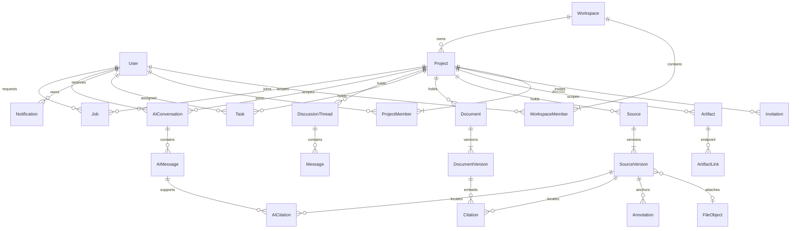

# Kavramsal veri modeli

Faz 03 güncellemesi: kavramsal modelin Document/DocumentVersion/Citation/Task/Discussion/Message/Notification/ArtifactLink alt kümesi additive 006 şemasında uygulanmıştır; fiziksel alanlar `prisma/schema.prisma` ve migration’da, kayıt/retention sınırları [ADR 0005](decisions/0005-documents-and-collaboration.md) içindedir. Aşağıdaki geniş model Faz 00 planıdır. Yalnız ilgili fazda gereken tablolar uygulanacak. Kimlik/erişim [AUTHORIZATION](AUTHORIZATION.md), atıf detayları [AI_AND_SOURCE_CONTRACT](AI_AND_SOURCE_CONTRACT.md) tarafından belirlenir.

## ERD

Artifact, tenant/resource FK'lerini ortak kimlikle doğrulamak için kavramsal registry'dir; her subtype için polymorphic string ID ile kontrolsüz bağ kurulmaz. ERD'de sadeleştirilmiş bağlantıların aynı-proje composite FK kuralları aşağıdadır. Auth Account/Session/Verification kayıtları kimlik modülünün ayrı şemasındadır; permission taşımaz.

## Sahiplik ve kimlik

| Nesne | Sahiplik, ilişki, temel invariant | İlk faz |
| --- | --- | --- |
| User / Session | Kullanıcı global kimliği, normalize benzersiz e-posta; session subject sunucuda doğrulanır; e-posta resource key değildir | 01 |
| Workspace | `personal` veya `shared`; personal için owner user benzersiz, tam bir aktif owner üyeliği; shared en az bir owner | 01 |
| WorkspaceMember | `(workspace_id,user_id)` benzersiz; owner/admin/member ve active/revoked; ortak üyelik özel proje okuma hakkı vermez | 01 |
| Project / ProjectMember | Tek workspace; project UUID; `(project_id,user_id)` benzersiz; açık owner/admin/editor/viewer. Aktif proje rolü için aktif aynı-workspace üyeliği ve en az bir proje owner gerekir | 01 |
| Invitation | Tek workspace/proje, davet edilen e-posta, editor/viewer hedef rol; admin daveti yalnız P owner; token hash/expiry/issuer ve kabul/revoke geçmişi. Gerekirse temel workspace member kabulde atomik açılır; owner devri ayrı işlemdir | 01 |
| Artifact | `(workspace_id,project_id,id)` unique; kind ve archived/deleted durumu; subtype FK aynı scope'u taşır | 02 temel, 03–04 genişleme |
| Source | Tek project; metadata + alan bazında DOI/provider/manual provenance; normalize DOI veya canonical URL proje içinde yinelenirse conflict/merge önerisi; global private dedupe yok | 02 |
| SourceVersion | Source'a bağlı immutable UUID, artan version ordinal, metadata snapshot/checksum/extraction status; PDF olmadan metadata-only sürüm olabilir | 02 |
| FileObject / UploadIntent | Tek proje, rastgele storage key, byte hash/MIME/size; staged→verified→ready veya failed; dosya yolu istemciden alınmaz; dosyasız sürüm izinli | 02 |
| Annotation | SourceVersion'a anchor; quote/selectors/page/rect + author ve revision; source değişiminde sessiz reanchor yok; annotation içeriği proje artifact'ıdır | 02 |
| Collection / Tag / ReadingState | Koleksiyon/tag proje içinde normalize adla unique; source join aynı proje. Okuma durumu kullanıcı+source için unique; koleksiyon paylaşılır, “benim okuma durumum” kişiseldir | 02 |
| Document / DocumentVersion | Tek proje; note ve document aynı temel belge türünün kind'ı. Current revision pointer; immutable sürümler, math/source refs; `(document_id,revision)` unique | 03 |
| Citation | UUID; DocumentVersion içindeki referans → aynı projedeki SourceVersion, locator ve quote snapshot; sıralı `[n]` gösterimi kimlik değildir | 03 |
| Task | Tek proje; assignee sıfır/bir aktif editor+; status backlog/in_progress/in_review/done; revision; display key `(project_id,sequence)` unique, global ID ayrı | 03 |
| DiscussionThread / Message | Proje thread'i; author, revision/edit marker, gönderim client ID; message linkleri aynı-proje Artifact'ları | 03 |
| Notification | Recipient user + hedef artifact/project; recipient bazında okunma; payload özel başlık/metin taşımayıp izinli okuma anında çözer; event+recipient unique | 03 |
| AIConversation / AIMessage | Tek proje ve owner user; owner + güncel proje erişimi gerekli. Scope source version listesi immutable; mesajlar ve retained output özel | 04 |
| AICitation / AIProposal | Yanıt segmenti → SourceVersion locator/quote/provenance; proposal target doc/revision ve state; apply açık kullanıcı eylemi | 04 |
| ArtifactLink | İki endpoint aynı workspace/project; kind `references/derived_from/follows_up/discusses`; `(project,from,to,kind)` unique, self-link reddi | 02–04 |
| Job / Outbox / Export / Usage | Actor/proje/operation/idempotency; lease/retry/state; export manifest ve expiry; usage reservation→settled/released; payload içerik değil ID taşır | 02–04 |

## DB'de uygulanacak ilişki kısıtları

Her proje kaydı `workspace_id, project_id` taşır. Project üzerinde `(workspace_id,id)` unique; alt kayıtlarda `(workspace_id,project_id,parent_id)` composite FK gerçek parent'a bağlanır. SourceVersion→Source, Annotation→SourceVersion, DocumentVersion→Document, Citation→DocumentVersion/SourceVersion, FileObject, thread/message ve link uçları bu kuralı izler. Artifact subtype'ı ile kind eşleşmesi denetlenir; registry ve subtype aynı transaction'da oluşturulur. RLS ilişki tutarlılığının yerine geçmez.

Assignee yalnız user FK'si değildir: aynı projenin aktif ProjectMember'ına bağlanır; atama servisinde editor+ kontrolü ve üyelik iptalinde görevleri unassign etme transaction'ı vardır. User'ı global bulup özel projeye kendiliğinden eklemek yoktur. Rol değişikliğiyle assignee editor altına düşerse de görevler unassign edilir; eski atama içeriksiz audit'te kalır.

Sürüm başına ordinal ve document revision optimistic concurrency için kullanılır; kaynak/version/citation dış linkleri immutable UUID'ye gider. DB primary key olarak başlık, DOI veya sıra numarası seçilmez. Farklı projedeki aynı makale ayrı Source/Version ve ayrı erişim alanıdır. Projeler arası move/merge veya çapraz link beta dışında; açık metadata ile yeniden ekleme eski özel annotation/AI çıktısını taşımaz.

## Arşiv, silme, saklama ve export

Arşiv proje içeriğini izinli kullanıcılara salt okunur tutar, yeni edit/upload/AI işini durdurur. Unarchive owner/admin işlemidir. Kaynak, doküman ve thread silme önce tombstone'a gider; mevcut atıf hedefi sessizce başka kaynağa yönlendirilmez. UI yalnız yetkili okuyucuya “silinmiş kaynak” gösterir; yetkisiz kişiye varlık açıklanmaz.

Önerilen beta saklama politikası: silinen içerik için 30 günlük kurtarma penceresi, süresi dolan export dosyası için 24 saat, başarısız geçici upload için 24 saat; süreler deployment öncesi ürün sahibi tarafından kabul edilir. Referans verilen source version, normal kaynak silmede atıf bütünlüğü için kurtarma/tombstone politikasında korunur. Kullanıcının kesin silme talebinde içerik byte'ları ve alıntılar purge edilir, atıf yalnız içeriksiz tombstone kimliği taşır. DB + file purge işi backup retention süresiyle birlikte belgelenir; “anında tüm yedeklerden silindi” denmez.

Hesap kapatmada önce personal export/uyarı, shared project ownership devri ve üyelik iptali gerekir. Yazarlık attribution'ı politika uygunsa anonimleştirilir; takımın dokümanını user cascade ile silmek yoktur. Son workspace/proje owner'ı devredilmeden ayrılma engellenir; workspace admin özel proje sahipliğini kendine geçiremez. Workspace silme ancak tüm proje owner'ları kendi projeleri için silme sürecini tamamladıktan sonra yapılabilir.

Export aynı-proje ve güncel erişim denetimli snapshot'tır. Faz 02 BibTeX/RIS metadata ve citation keys; Faz 03 Markdown + math + kaynak referans manifest'i; PDF byte'ları otomatik eklenmez. Bir export'ta source/version/citation UUID'leri ve locator durumu korunur; başka Atlas projesine permission taşıyan import paketi değildir. Kişisel AI geçmişi varsayılan export'a eklenmez. Export job üretiminde ve indirmede aktör yetkisi yeniden denetlenir; download URL public capability olmaz.

Metadata/search/AI artifact'larında revision ve deletion propagation olayları outbox'tan geçer. Backup ve purge güvenilirliği [COOLIFY_PLAN](COOLIFY_PLAN.md), negatif bütünlük testleri [VERIFICATION_PLAN](VERIFICATION_PLAN.md) içindedir.
